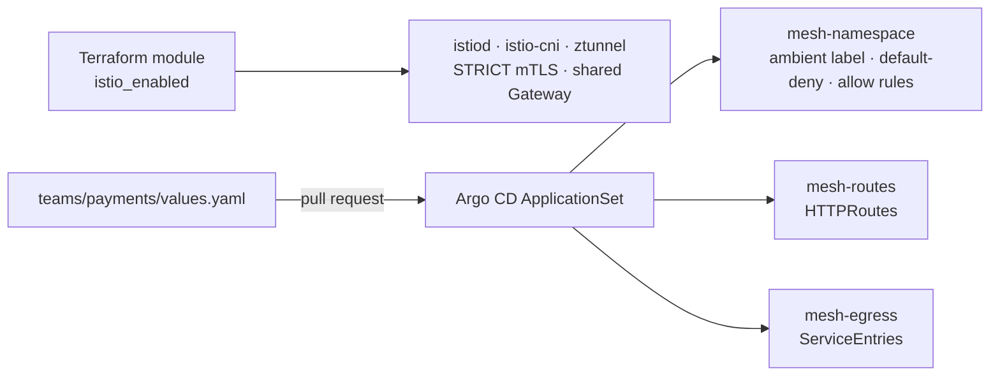

# istio-ambient-building-block

A zero-trust service mesh as a self-service building block: [Istio ambient mode](https://istio.io/latest/docs/ambient/) on Kubernetes, installed behind one feature flag, with team onboarding through one values file and Argo CD.

The same approach delivered, in three months, a service mesh that a regulated online-gaming launch in New Jersey had been waiting for 1.5 years: encrypted and mutually authenticated traffic between all services, deny by default, and evidence for auditors. Teams join in about ten minutes, without changing application code. This repository is a clean-room rewrite of the pattern and contains no code from that project.

## What you get

- **No sidecars.** ztunnel on every node carries mTLS for all pods of enrolled namespaces; joining or leaving the mesh needs no pod restarts.
- **Zero trust by default.** STRICT mTLS mesh-wide, `default-deny` in every team namespace, allow rules by SPIFFE identity, and a NetworkPolicy that lets only mesh traffic in.
- **L7 only where needed.** A namespace turns on a waypoint for HTTP authorization, retries and header routing; ingress then goes through the same waypoint.
- **Gateway API** for north-south traffic: one shared `Gateway`, `HTTPRoute`s per team.
- **Self-service.** A team writes one values file and opens a pull request; an Argo CD ApplicationSet creates the namespace, policies, routes and egress allowlist.
- **Contracts.** JSON schemas reject broken team files in CI: wrong keys, invalid ports, bad names.
- **Observability.** Kiali with single sign-on, metrics, tracing through waypoints, alerts with runbooks.



## Repository layout

```
terraform/modules/istio-ambient   Istio 1.31 (base, istiod, cni, ztunnel), mesh-baseline chart, Kiali
terraform/examples/eks            the module on an existing EKS cluster
charts/mesh-namespace             team namespace: ambient, default-deny, allow rules, waypoint, NetworkPolicy
charts/mesh-routes                Gateway API routes to the shared gateway
charts/mesh-egress                external hosts as ServiceEntries
argocd/mesh-onboarding.yaml       ApplicationSet: one Application per team values file
examples/teams/payments           a complete team file
scripts/validate.sh               lint, render and schema-validate everything
docs/                             architecture, onboarding, validation plan, observability
```

## A team's whole configuration

```yaml
namespace: payments

allowFrom:
  - namespace: payments
  - namespace: istio-ingress
    serviceAccounts: [public-istio]
  - namespace: orders
    serviceAccounts: [checkout]

ingress:
  allowed: true

routes:
  - name: payments-api
    hostnames: [api.payments.example.com]
    rules:
      - pathPrefix: /
        service: payments-api
        port: 8080

egress:
  hosts:
    - name: payment-provider
      host: api.payment-provider.example
      port: 443
      protocol: TLS
```

Step by step: [docs/onboarding.md](docs/onboarding.md).

## Installing the mesh

```hcl
module "mesh" {
  source = "./terraform/modules/istio-ambient"

  istio_enabled = true

  ingress = {
    hostname           = "*.payments-dev.example.com"
    certificate_issuer = { name = "letsencrypt-dns" }
  }
}
```

Prerequisites, security model and rollout: [docs/architecture.md](docs/architecture.md).

## Checks

Everything is validated without a cluster, locally and in CI:

```bash
terraform fmt -check -recursive terraform
terraform -chdir=terraform/examples/eks init -backend=false && terraform -chdir=terraform/examples/eks validate
scripts/validate.sh   # helm lint, helm template | kubeconform with Istio, Gateway API, cert-manager and Argo CD schemas
shellcheck scripts/*.sh
```

`scripts/validate.sh` also renders the waypoint and rollback variants and checks that broken team files are rejected.

Before production, run the [validation plan](docs/validation-plan.md) in a real cluster: ingress, east-west allowed and denied, plain text from outside the mesh, egress, an external database, health probes, waypoint and rollback.

## Author

Mher Poghosyan, Senior DevOps & Platform Engineer, Yerevan, Armenia.
[LinkedIn](https://www.linkedin.com/in/mher-poghosyan/) · [GitHub](https://github.com/devopsmher) · [Medium](https://medium.com/@mher.poghosyan)

## License

[MIT](LICENSE)
