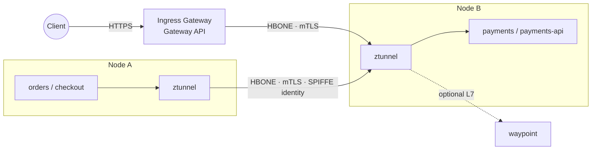

# Architecture

## Components

| Component | Where | Job |
|---|---|---|
| istiod | `istio-system` | Control plane: certificates, configuration, workload identities |
| istio-cni | DaemonSet | Redirects traffic of enrolled pods to ztunnel; no sidecar injection |
| ztunnel | DaemonSet, one per node | L4 proxy: mTLS between workloads over HBONE (port 15008), L4 authorization, telemetry |
| waypoint | Optional, per namespace | L7 proxy: HTTP authorization, retries, header routing, L7 telemetry |
| Ingress Gateway | `istio-ingress` | North-south entry, configured with the Kubernetes Gateway API |



## Security model

Two layers, each doing one job:

1. **Identity: AuthorizationPolicy.** Every workload has a SPIFFE identity, `cluster.local/ns/<namespace>/sa/<service account>`. Each team namespace starts with `default-deny` and allows only the callers listed in its values file. ztunnel enforces these rules at L4; with a waypoint, the waypoint enforces them and ztunnel admits only the waypoint.
2. **Transport: STRICT mTLS and NetworkPolicy.** `PeerAuthentication` in `istio-system` makes STRICT mTLS mesh-wide. A `NetworkPolicy` per namespace admits only HBONE on port 15008 and kubelet probes, which istio-cni rewrites to the link-local addresses `169.254.7.127` and `fd16:9254:7127:1337:ffff:ffff:ffff:ffff`. Plain-text traffic cannot bypass the mesh, even from pods outside it.

A CNI with NetworkPolicy support (for example Calico) enforces the second layer; Istio enforces the first.

## Rollout behind a feature flag

- `istio_enabled` in the Terraform module installs or removes the whole mesh. It is off by default.
- Installing the mesh changes nothing for running workloads: a namespace joins only when it gets the `istio.io/dataplane-mode=ambient` label from the `mesh-namespace` chart.
- Leaving the mesh is `enrolled: false` in the team file: the label and the `mesh-only` NetworkPolicy go away together. No pod restarts in either direction, because there are no sidecars.
- The team namespace is never deleted with its chart or Argo CD Application: it carries `helm.sh/resource-policy: keep` and `argocd.argoproj.io/sync-options: Delete=false`.

## Gateway API everywhere

North-south traffic uses the Kubernetes Gateway API: one shared `Gateway` and one `HTTPRoute` per team route. The same model works with other Gateway API implementations, such as Envoy Gateway, so teams learn one set of resources.

A namespace may attach routes to the shared gateway only if it carries the `mesh.example.io/ingress=allowed` label, which `mesh-namespace` sets from `ingress.allowed`.

## Prerequisites

- Kubernetes 1.30 or newer; Istio 1.31.4 is pinned in the module.
- Gateway API CRDs v1.6.0, the version documented for Istio 1.31:
  ```bash
  kubectl apply --server-side -f https://github.com/kubernetes-sigs/gateway-api/releases/download/v1.6.0/standard-install.yaml
  ```
- cert-manager with a DNS-01 `ClusterIssuer`, if the module should request the gateway certificate.
- A CNI that enforces NetworkPolicy.
